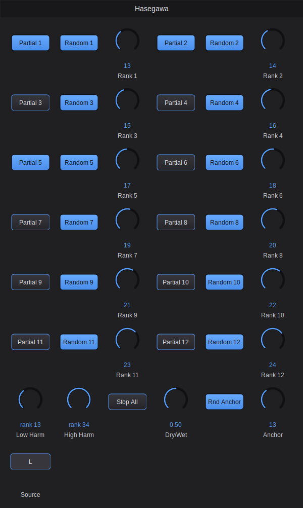

# Hasegawa

A **virtual-fundamental harmonizer** audio plugin (phase-vocoder based), built
with [Avendish](https://github.com/celtera/avendish) using
[TimeMachine](https://github.com/edumeneses/TimeMachine) as a template.



## Concept

Robert Hasegawa (2006; 2008; 2009) has proposed that complex harmonies, such
as those found in Schoenberg and Grisey, can be understood as upper partials
of a hypothetical *virtual fundamental*. This plugin turns that analytical
model into a real-time instrument: the incoming pitch is aleatorically
assigned a harmonic rank, and the plugin harmonizes it with up to 12
additional pitches drawn from the same harmonic series; when the ranks sit
high enough in the series, the sense of tonality may become obscured. Each of
the 12 harmonized pitches is an individually switchable voice, and the plugin
outputs their mix.

Since the ideal harmonic series is infinite, any combination of notes can be
described as harmonics of some fundamental; the analysis only becomes
musically meaningful, however, within a finite range determined by auditory
perception. In Hasegawa's nomenclature, Eb1(13:17:18:20) can be a relevant
representation of a complex harmony, while Eb-3(73:98:112:157) cannot: its
hypothetical fundamental falls well below the range of human hearing, and the
relations among its designated partials are too complex to be intelligible.
Recognizing that intervals built from higher integers become difficult to
comprehend, Hasegawa limits his tone representations to the first 34 partials
(2009); the plugin adopts the same limit.

The instrument explores the hypothesis that complex harmonies analyzable as
partials of a virtual fundamental, within a perceptually relevant range,
exhibit a greater degree of perceptual coherence, a quality we can call
*virtual toneness*; harmonies that resist such analysis exhibit less
coherence, or *virtual noisiness*. In other words, the instrument extends the
tone-noise axis explored by composers such as Lachenmann and Saariaho into
the domain of spectral implication described by Hasegawa. Drawing the
harmonic ranks from low in the series produces strong fusion and quasi-tonal
sonorities; drawing them from high in the series produces obscure, noisy
ones; the *Low Harm* and *High Harm* controls sweep along exactly that axis.

## How it works

The plugin is a **real-time harmonizer** with **12 individually switchable
partials**, mixed into a single master output. Nothing is recorded or frozen.
An open partial continuously pitch-shifts the live input until it is closed.

1. **Anchor**: when the first partial opens, the plugin sets a harmonic rank
   `r` (the *anchor*). With *Rnd Anchor* on (default), `r` is drawn
   uniformly at random from `[Low Harm, High Harm]`. With *Rnd Anchor*
   off, `r` is the value of the *Anchor* knob, and the open partials retune
   when the knob moves. The incoming pitch is *declared* to be partial `r` of
   a virtual fundamental `f0 = f_input / r`. The anchor holds as long as at
   least one partial is open, so everything sounding belongs to one series.
   It is cleared when all partials close (or on *Stop All*).
2. **Opening a partial**: toggling *Partial N* on picks that voice's rank
   `rank_N` and opens a voice at `f_N = f0 · rank_N` (a pitch shift of the
   live input by the just ratio `rank_N / r`). In *Random* mode (default) the
   rank is drawn from the same `[Low Harm, High Harm]` range, distinct from
   the anchor and from the other open partials whenever the range allows. In
   manual mode the rank comes from the *Rank N* knob, and the open voice
   follows the knob live. Toggling the partial off closes the voice.
3. **Resynthesis**: each voice is a phase-vocoder transposition of the live
   input (STFT 2048, hop 512, Hann). The analysis stage (one forward FFT per
   hop) is shared by all voices. Each open voice scatters the analyzed
   spectrum to its pitch-scaled bins with its own running synthesis phase,
   and the voices' spectra are summed and rendered through a single inverse
   FFT and overlap-add.

The ratios are pure rank arithmetic (`rank_N / r`), so the harmonizer tracks
whatever the input does — dynamics, timbre, glissandi — as parallel just-ratio
transposition, in real time (latency: one STFT window, ~43 ms at 48 kHz).

Because every voice is a *just* ratio of small-to-moderate integers over a
common virtual fundamental, the resulting chord is a literal cutting of the
harmonic series — coherent ("virtually tonal") when the ranks are low and
close, increasingly obscure ("virtually noisy") as the ranks climb toward 34.

## Controls

| Control            | Range  | Function |
|--------------------|--------|----------|
| **Low Harm**        | 1 to 34 | Lowest harmonic rank eligible for the aleatoric draws (anchor and partials). |
| **High Harm**       | 1 to 34 | Highest harmonic rank eligible for the aleatoric draws (anchor and partials). |
| **Rnd Anchor**      | toggle  | Anchor mode. On (default): the anchor is drawn aleatorically in [*Low Harm*, *High Harm*] when the first partial opens. Off: the anchor comes from the *Anchor* knob. |
| **Anchor**          | 1 to 34 | Manually chosen anchor rank, used when *Rnd Anchor* is off. Open partials retune live when it moves. Not constrained by [*Low Harm*, *High Harm*]. |
| **Partial 1 to 12** | toggle  | On: pick a rank (see *Random N* / *Rank N*) and open that voice (real-time harmonization of the live input, added to the master mix). Off: close it. Cycle off/on to redraw. |
| **Random 1 to 12**  | toggle  | Rank mode per partial. On (default): the rank is drawn aleatorically in [*Low Harm*, *High Harm*] when the partial opens. Off: the partial uses its *Rank N* knob. |
| **Rank 1 to 12**    | 1 to 34 | Manually chosen harmonic rank, used when *Random N* is off. An open partial follows this knob live. Not constrained by [*Low Harm*, *High Harm*]. |
| **Stop All**        | bang    | Closes every partial and clears the series anchor. Partial toggles left on stay closed until cycled off/on. |
| **Dry/Wet**         | 0 to 1  | Crossfade between the live input (each output channel takes its own input channel) and the mix of the open partials. |
| **Source**          | L, R, L+R | Harmonizer source. *L* (default): input channel 1. *R*: input channel 2. *L+R*: their average, for a stereo source. With a mono input, every choice reads that channel. |

This maps the original message-based specification
(`play <bufferNumber> <number_of_harmonics> <low_harm> <high_harm>`, `stop`
per partial, `stopAll`) onto plugin parameters: each partial toggle plays or
stops one voice (`bufferNumber` = which toggle; `number_of_harmonics` = how
many toggles you open), and `low_harm` / `high_harm` are read from the knobs
at the moment a partial opens.

## Audio I/O

The buses are dynamic, so the plugin adapts to the channel count the host
provides:

- **Input**: *Source* picks the harmonizer source (input channel 1, input
  channel 2, or their average). With a single input channel, every choice
  reads that channel.
- **Output**: each output channel carries its own input channel as the dry
  signal, crossfaded by *Dry/Wet* with the mix of the open partials
  (normalized by 1/√(open partials), the same on every channel). An output
  channel past the last input channel takes the last input channel as its dry
  signal.

A mono track therefore gets a mono output. On a stereo track the dry signal
keeps its stereo image and the partials sit in the centre. The harmonizer
follows a single pitch, so pick *L* or *R* when the source is on one side
only, and *L+R* for a stereo source (averaging a one-sided signal halves its
level).

## One partial per track

To process or spatialize partials separately, run one instance per partial in
parallel (for example, one REAPER track per partial, each fed by the same
source). With *Rnd Anchor* on, each instance draws its own anchor, so the
instances belong to different series. To keep them on one virtual
fundamental, set every instance as follows:

- *Rnd Anchor* off, with the same *Anchor* value on every instance.
- One partial open per instance, with *Random N* off and its own *Rank N*.
- *Dry/Wet* at 1 on every instance except at most one, so the dry signal is
  heard once.

Random rank draws also work with a shared manual anchor. However, each
instance draws independently, so two instances can land on the same rank.

## Download

Pre-built VST3 plugins for Windows, Linux and macOS are published as a rolling
"Continuous build" release. Grab the latest from the
[Releases page](../../releases/tag/continuous).

## Build

`CMakeLists.txt` follows the upstream template (`avnd_addon_init` /
`avnd_addon_object` / `avnd_addon_finalize`) and fetches **Avendish** and
**pffft** automatically. You provide a C++20 compiler, the **Steinberg VST3
SDK**, and **Boost** headers:

```bash
git clone --recursive https://github.com/steinbergmedia/vst3sdk

cmake -S . -B build \
  -DCMAKE_BUILD_TYPE=Release \
  -DVST3_SDK_ROOT="$PWD/vst3sdk" \
  -DBOOST_ROOT=/path/to/boost \
  -DSMTG_ENABLE_VSTGUI_SUPPORT=OFF -DSMTG_ADD_VSTGUI=OFF \
  -DSMTG_CREATE_PLUGIN_LINK=OFF

cmake --build build --target avnd_hasegawa_vst3
```

The compiled VST3 bundle is written under `build/vst3/avnd_hasegawa.vst3`.

The exact, reproducible build for every platform lives in
[`.github/workflows/build_cmake.yml`](.github/workflows/build_cmake.yml),
which mirrors ossia's `avnd-addon` recipe and produces the rolling release.
(The upstream template drives CI from ossia's reusable workflow; that
workflow's access is org-restricted, so this fork ships an equivalent
self-contained build instead.)

## License

This project is licensed under the [GNU General Public License v3.0](LICENSE).

## References

- Hasegawa, R. (2006). "Tone Representation and Just Intervals in
  Contemporary Music." *Contemporary Music Review* 25(3), 263–281.
- Hasegawa, R. (2008). *Just Intervals and Tone Representation in
  Contemporary Music.* PhD dissertation, Harvard University.
- Hasegawa, R. (2009). "Gérard Grisey and the 'Nature' of Harmony."
  *Music Analysis* 28(2–3), 349–371.
